# Agenda Fácil Acadêmico — Documentação de Arquitetura e Código

Este documento descreve **o que cada classe e função faz, como elas se relacionam, quais padrões de projeto foram usados e por quê**. Ele foi escrito a partir da leitura do código em `backend/` e `frontend/` (commit `03e8a38`). Complementa o `README.md` (como rodar), o `docs/prd.md` (requisitos) e o `docs/api.md` (contrato HTTP).

## Sumário

1. [Visão geral](#1-visão-geral)
2. [Arquitetura do backend](#2-arquitetura-do-backend)
3. [Fluxos da aplicação (diagramas de sequência)](#3-fluxos-da-aplicação)
4. [Backend: referência por contexto](#4-backend-referência-por-contexto)
5. [Padrões de projeto do backend (diagramas de classe)](#5-padrões-de-projeto-do-backend)
6. [Banco de dados](#6-banco-de-dados)
7. [Frontend: arquitetura e referência](#7-frontend-arquitetura-e-referência)
8. [Padrões de projeto do frontend (diagramas de classe)](#8-padrões-de-projeto-do-frontend)
9. [Decisões transversais, pontos de atenção e testes](#9-decisões-transversais-pontos-de-atenção-e-testes)

---

## 1. Visão geral

Sistema para estudantes da UCSal agendarem atendimento de **30 minutos** com Coordenação, Professor ou CRA. O estudante se cadastra (e-mail `@ucsal.edu.br`), escolhe tipo → responsável → horário → motivo, recebe um código `AGD-AAAA-NNN` e pode listar, cancelar e reagendar.

| Camada | Tecnologia |
|---|---|
| Backend | Java 21, Spring Boot 4.1, Spring Data JPA, Spring Security (resource server JWT HS256), Flyway, springdoc-openapi |
| Banco | PostgreSQL 18 (Testcontainers nos testes) |
| Frontend | React, Vite, TypeScript, React Router, Tailwind, shadcn/ui |

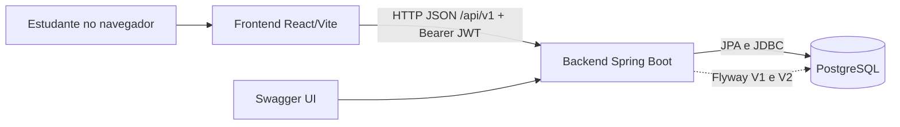

Em desenvolvimento, o proxy do Vite (`vite.config.ts`) encaminha `/api` para `localhost:8080` e remove o header `Origin`, de modo que a requisição é *same-origin* para o navegador.

---

## 2. Arquitetura do backend

O backend é um **monólito modular** com três *bounded contexts* (`identity`, `catalog`, `scheduling`) mais um `shared` e um `bootstrap`. Cada contexto segue **Clean Architecture com Ports and Adapters** (camadas e regra de dependência da Clean Architecture; as fronteiras são portas, interfaces declaradas pelo núcleo, e adapters, implementados na infraestrutura) em quatro camadas:

```
<contexto>/
  presentation/    controllers REST + DTOs de request/response (borda HTTP)
  application/     handlers (casos de uso), commands/queries, views, ports de saída
  domain/          model (aggregates, entities, value objects), repository (interfaces), exception
  infrastructure/  persistence (JPA + adapters), integration (adapters entre contextos), security
```

**Regra de dependência:** `presentation → application → domain`. A `infrastructure` implementa interfaces declaradas em `domain`/`application` (inversão de dependência). O domínio não importa Spring nem JPA.

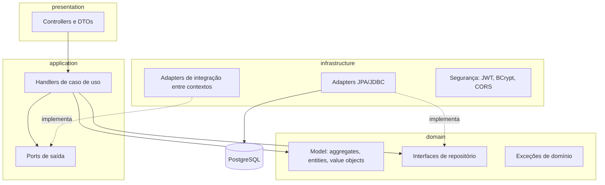

### 2.1 Relação entre os contextos

Os contextos **não compartilham classes de domínio**. Quando um precisa de dados do outro, declara um **port** no seu lado `application` e um **adapter** em `infrastructure/integration` que chama o *handler* público do outro contexto (nunca o repositório dele).

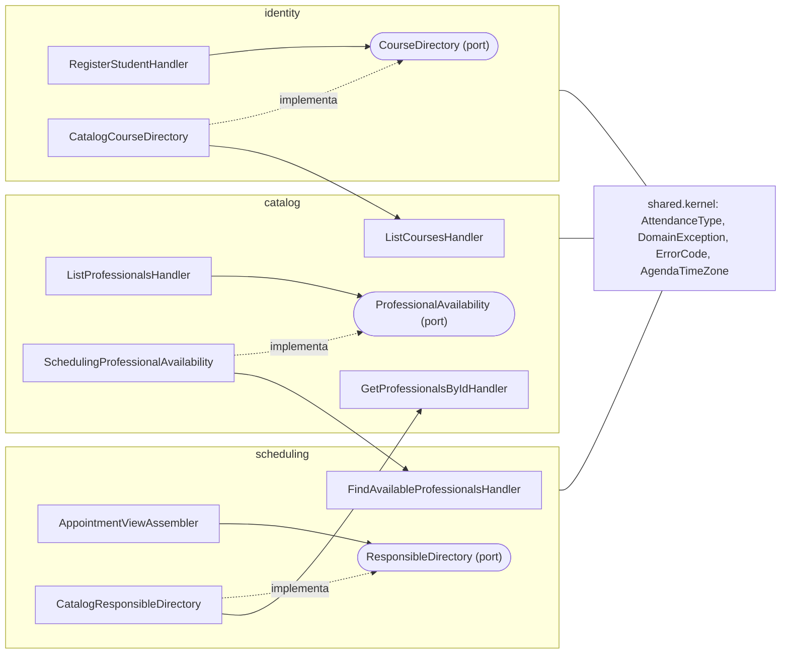

Existe dependência de *módulo* nos dois sentidos entre `catalog` e `scheduling` (catálogo pergunta disponibilidade; agendamento pergunta nome do responsável), mas **não há ciclo de beans**: cada seta passa por um adapter distinto e os handlers envolvidos são diferentes.

### 2.2 Ciclo de vida de uma requisição

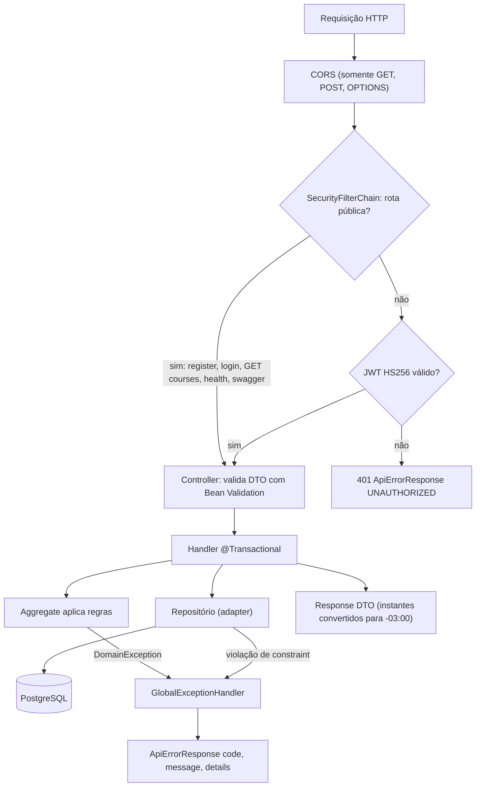

---

## 3. Fluxos da aplicação

### 3.1 Cadastro e login

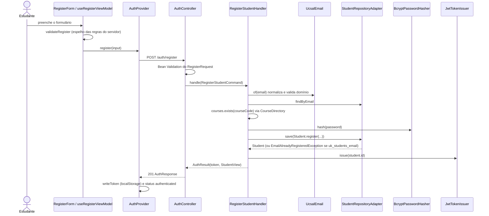

O **login** é análogo: `LoginHandler` valida o e-mail com `UcsalEmail.of`, busca o aluno, compara o hash e emite o JWT. Todos os caminhos de falha (domínio inválido, e-mail inexistente, senha errada) lançam a **mesma** `UnauthorizedException("E-mail ou senha inválidos.")`, para não revelar quais e-mails existem.

### 3.2 Restauração e expiração de sessão (frontend)

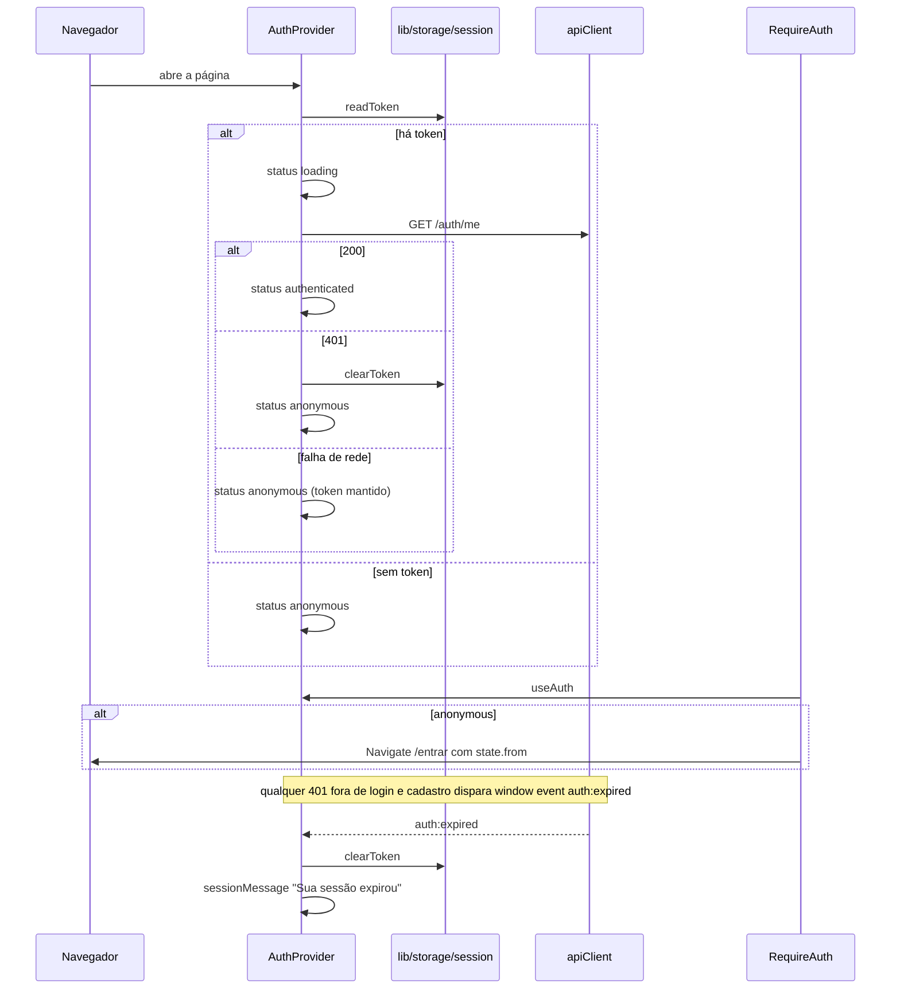

### 3.3 Fluxo de agendamento (telas)

O rascunho (`BookingDraft`) vive em um `useReducer` dentro de `BookingProvider`, acima de todas as rotas do fluxo. **CRA pula a etapa "Responsável".**

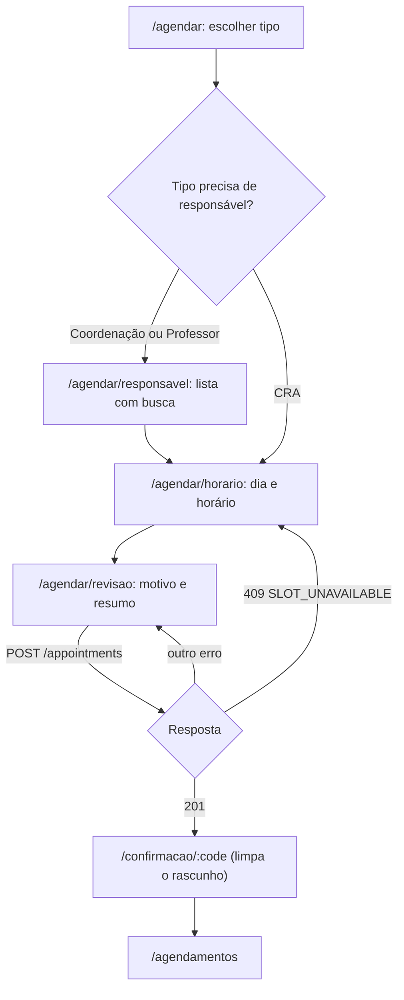

Se alguém tentar abrir `/agendar/horario` sem ter completado os passos anteriores, `RequireBookingStep` + `isStepReachable` redireciona para `/agendar`.

### 3.4 Criar agendamento (backend) e controle de concorrência

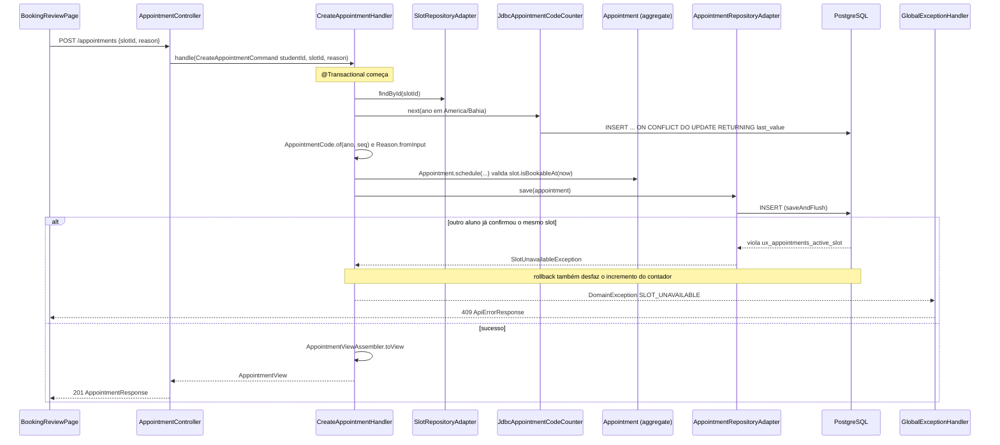

**Por que assim:** a garantia contra dupla marcação (RF-12) não depende de "checar e depois gravar" na aplicação (que teria condição de corrida). O banco tem um **índice único parcial** (`ux_appointments_active_slot ... WHERE status = 'CONFIRMED'`). A aplicação apenas **traduz** a violação em `SlotUnavailableException`. Cancelar libera o horário automaticamente, pois o índice só considera linhas `CONFIRMED`.

### 3.5 Listar horários e disponibilidade

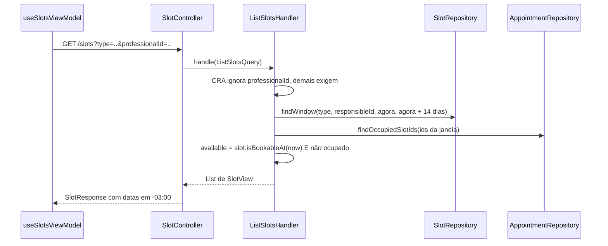

A "disponibilidade" **não é coluna do slot**: é derivada (`slot agendável` e `sem agendamento CONFIRMED`). Isso evita duas fontes de verdade.

### 3.6 Listar responsáveis com `hasSlots` (fluxo entre contextos)

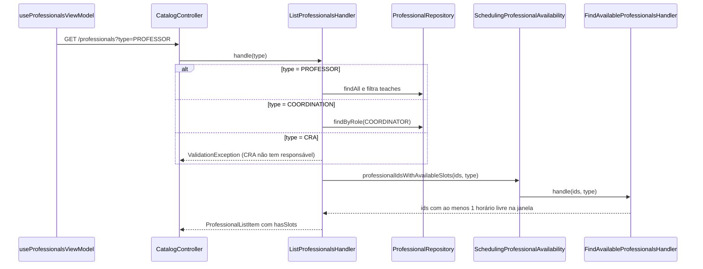

### 3.7 Cancelar e reagendar

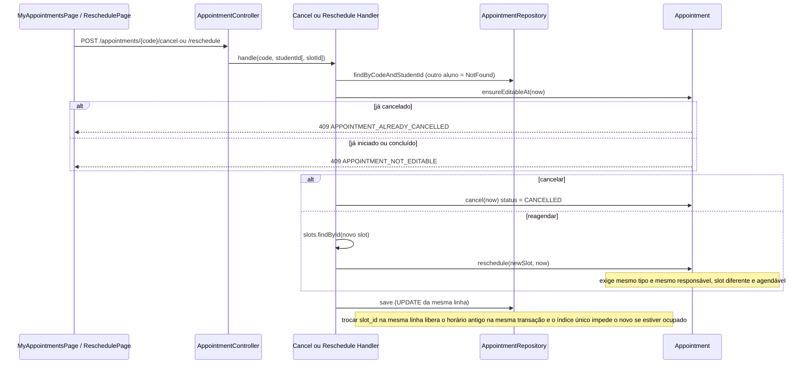

No frontend, o resultado define a navegação: sucesso → `/agendamentos/:code/cancelado` ou `/reagendado`; `409` → `/agendamentos/:code/erro/:motivo`; `SLOT_UNAVAILABLE` no reagendamento → limpa a seleção e recarrega a grade.

### 3.8 Máquina de estados do agendamento

`CONFIRMED` e `CANCELLED` são **persistidos**. `COMPLETED` é **derivado** na leitura (`statusAt(now)`: confirmado cujo `endsAt` já passou).

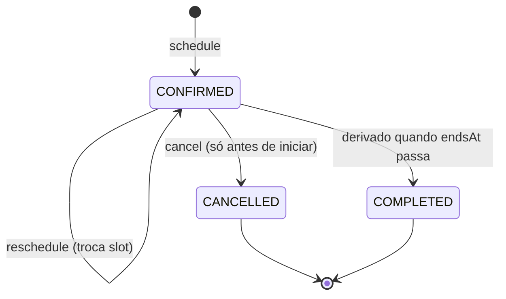

### 3.9 Tratamento de erros ponta a ponta

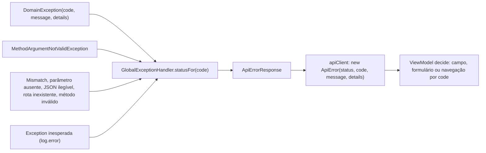

| `ErrorCode` | HTTP |
|---|---|
| `VALIDATION_ERROR`, `INVALID_EMAIL_DOMAIN` | 400 |
| `UNAUTHORIZED` | 401 |
| `NOT_FOUND` | 404 |
| `EMAIL_ALREADY_REGISTERED`, `SLOT_UNAVAILABLE`, `APPOINTMENT_ALREADY_CANCELLED`, `APPOINTMENT_NOT_EDITABLE` | 409 |
| (não é `ErrorCode`) `METHOD_NOT_ALLOWED` / `INTERNAL_ERROR` | 405 / 500 |

O `switch` em `statusFor` não tem `default`: ao adicionar um `ErrorCode`, o compilador obriga a mapear o status.

---

## 4. Backend: referência por contexto

Convenção: todos os métodos de handler se chamam `handle` (um caso de uso por classe).

### 4.1 `AgendaApplication` e `bootstrap`

| Classe | Papel |
|---|---|
| `AgendaApplication` | `main` do Spring Boot. |
| `DemoDataSeeder` (`ApplicationRunner`) | **Composition root dos dados de demonstração.** A cada boot, `run()` valida `DEMO_PASSWORD` (8 a 72 caracteres), executa `TRUNCATE` de todas as tabelas e recria 3 cursos, 4 profissionais, os horários e a conta demo (`demo.aluna@ucsal.edu.br`). Usa as interfaces de repositório e o `RegisterStudentHandler` (a senha da demo passa pelo mesmo hashing do cadastro real). `seedSlots` gera horários 09:00–11:30 e 14:00–16:30 em dias úteis da janela de 14 dias, descartando os que `isBookableAt` rejeita. Cenários cobertos de propósito: Marina sem horários (`hasSlots=false`), Tânia coordena **e** leciona, Heitor só coordena. |

### 4.2 `shared`

| Classe | O que faz | Relações |
|---|---|---|
| `kernel.AttendanceType` | Enum `COORDINATION`, `PROFESSOR`, `CRA`. **Shared kernel**: único conceito de domínio compartilhado entre contextos. | Usado por catalog, scheduling e controllers. |
| `kernel.AgendaTimeZone` | Constante `ZONE = America/Bahia`. Instantes são guardados em UTC; a zona só é usada para o ano do código e para exibição. | `CreateAppointmentHandler`, `ApiDateTimes`, `DemoDataSeeder`. |
| `kernel.DomainException` | Base abstrata de toda regra de negócio violada. Carrega `ErrorCode` e lista imutável de `FieldError`. | Todas as exceções de domínio herdam dela. |
| `kernel.ErrorCode` | Enum de códigos do contrato. | Mapeado para HTTP em `GlobalExceptionHandler`. |
| `kernel.FieldError` | Record `(field, message)`. | Detalhes de validação. |
| `kernel.NotFoundException`, `UnauthorizedException`, `ValidationException` | Exceções genéricas. `ValidationException` tem dois construtores: só mensagem, ou campo + mensagem (vira `details`). | Lançadas por aggregates e handlers. |
| `infrastructure.config.ClockConfig` | Expõe `Clock.systemUTC()` como bean. Handlers recebem `Clock` e passam `now` ao domínio, o que torna as regras de tempo testáveis. | Todos os handlers e `JwtTokenIssuer`. |
| `infrastructure.persistence.ConstraintViolations` | `violates(e, nome)`: olha a causa mais específica de `DataIntegrityViolationException` e confere se cita a constraint. Evita confundir unicidades diferentes. | `AppointmentRepositoryAdapter`. |
| `presentation.ApiDateTimes` | `toApi(Instant)`: converte UTC para `OffsetDateTime` em `America/Bahia` (`-03:00`). | Responses de agendamento e slot. |
| `presentation.ApiErrorResponse` | Envelope de erro `{code, message, details[]}`. | `GlobalExceptionHandler`, `SecurityConfig`. |
| `presentation.CurrentUser` | `id(Jwt)`: o `subject` do JWT é o UUID do estudante. | Todos os controllers autenticados. |
| `presentation.GlobalExceptionHandler` | `@RestControllerAdvice`, **único ponto** que traduz exceção em HTTP. Cobre domínio, validação do body, JSON ilegível, tipo de parâmetro errado, parâmetro ausente, rota inexistente, método não permitido e erro inesperado (loga e responde 500 genérico, sem vazar detalhes). | Ver 3.9. |

### 4.3 Contexto `identity`

**Domain**

| Classe | O que faz |
|---|---|
| `Student` | *Aggregate root*. Imutável. `register(...)` é a fábrica com validação (nome e hash não vazios, `strip` no nome); `restore(...)` reconstitui do banco sem revalidar. Guarda o **hash**, nunca a senha. |
| `UcsalEmail` | *Value object*. `of(raw)` normaliza (`strip` + minúsculas) e exige sufixo `@ucsal.edu.br` com parte local não vazia, sem `@` extra nem espaços; senão `InvalidEmailDomainException`. Igualdade por valor. Valida o domínio, **não** a posse do endereço (sem confirmação por e-mail, por decisão de MVP). |
| `StudentRepository` | Interface: `findById`, `findByEmail`, `save` (contrato: lança `EmailAlreadyRegisteredException` se a unicidade do banco falhar). |
| `EmailAlreadyRegisteredException`, `InvalidEmailDomainException` | Exceções com `ErrorCode` próprio. |

**Application**

| Classe | O que faz |
|---|---|
| `RegisterStudentHandler` | `@Transactional`. Valida e-mail, checa duplicidade, confere o curso via port `CourseDirectory`, faz hash, salva, emite token. `toView` (package-private estático) converte `Student` em `StudentView`, reaproveitado por Login e GetCurrent. |
| `LoginHandler` | `@Transactional(readOnly)`. Mensagem única para qualquer falha (anti-enumeração). |
| `GetCurrentStudentHandler` | Retorna o aluno do token, ou `NotFoundException`. |
| `RegisterStudentCommand`, `LoginCommand` | Records de entrada. |
| `AuthResult` (+ `StudentView`) | Saída: token e dados do aluno. |
| Ports `CourseDirectory`, `PasswordHasher`, `TokenIssuer` | Contratos de saída. O handler não conhece BCrypt, JWT nem o catálogo. |

**Infrastructure**

| Classe | O que faz |
|---|---|
| `StudentJpaEntity`, `StudentJpaRepository` | Mapeamento da tabela `students` e Spring Data. `StudentJpaRepository` é package-private. |
| `StudentRepositoryAdapter` | Implementa `StudentRepository`. Converte entity ↔ domínio (`toDomain` usa `restore`). `save` usa `saveAndFlush` para a constraint estourar **dentro** do `try`. |
| `CatalogCourseDirectory` | Adapter anti-corrupção: `exists` consulta `ListCoursesHandler` (do catálogo). |
| `BcryptPasswordHasher` | Implementa `PasswordHasher` com `PasswordEncoder`. |
| `JwtTokenIssuer` | Implementa `TokenIssuer`: JWT HS256, issuer `agenda-facil`, subject = id do aluno, expiração configurável (`JWT_EXPIRATION`, padrão 24 h), relógio injetado. |
| `SecurityConfig` | Cadeia de segurança **stateless** (sem sessão, CSRF desligado porque não usa cookie), rotas públicas explícitas e `anyRequest().authenticated()`. Beans de `SecretKey` (falha no boot se `JWT_SECRET` < 32 bytes), `JwtEncoder`, `JwtDecoder`, `PasswordEncoder` (BCrypt) e CORS. O `AuthenticationEntryPoint` escreve o mesmo envelope `ApiErrorResponse` com `UNAUTHORIZED`. |
| `OpenApiConfig` | Declara o esquema Bearer JWT no Swagger. |

**Presentation:** `AuthController` expõe `POST /auth/register` (201), `POST /auth/login`, `GET /auth/me`. Valida **formato** na borda (Bean Validation) e deixa a **regra de domínio** do e-mail para `UcsalEmail`. DTOs aninhados: `RegisterRequest`, `LoginRequest`, `AuthResponse`, `UserResponse`.

### 4.4 Contexto `catalog`

| Classe | O que faz |
|---|---|
| `Course` (entity) | Identificada pelo `code` (maiúsculo). `create` valida; `restore` reconstitui. |
| `Professional` (aggregate root) | Invariantes em `create`: nome obrigatório; **coordenador exige curso**; **professor não tem curso**; **professor sempre leciona** (`teaches`). Coordenador pode ou não lecionar. |
| `ProfessorRole` | `PROFESSOR`, `COORDINATOR`. |
| `CourseRepository`, `ProfessionalRepository` | Interfaces do domínio (`findAll`, `findByRole`, `findByIds`, `save`). |
| `ListCoursesHandler` | Lista cursos. Usado pelo controller **e** pelo adapter de `identity`. |
| `ListProfessionalsHandler` | Para `PROFESSOR` filtra `teaches`; para `COORDINATION` usa `findByRole(COORDINATOR)`; `CRA` → `ValidationException`. Ordena por nome, resolve nome do curso e consulta o port `ProfessionalAvailability` para `hasSlots`. |
| `GetProfessionalsByIdHandler` | Resumos em lote por ids (para o agendamento exibir o responsável). |
| `ProfessionalAvailability` (port) | "Quais destes profissionais têm horário livre?". Implementado pelo agendamento. |
| `SchedulingProfessionalAvailability` | Adapter: delega a `FindAvailableProfessionalsHandler`. |
| `CourseJpaEntity`, `ProfessionalJpaEntity` + `*JpaRepository` + `*RepositoryAdapter` | Persistência no padrão Repository/Adapter. |
| `CatalogController` | `GET /courses` (público) e `GET /professionals?type=`. |
| `CourseView`, `ProfessionalListItem`, `ProfessionalSummary` | DTOs de aplicação (leitura). |

### 4.5 Contexto `scheduling`

**Domain**

| Classe | O que faz |
|---|---|
| `Slot` | Horário de 30 min. Constantes `DURATION` e `BOOKING_WINDOW` (14 dias). `create` impõe: CRA **sem** responsável, os demais **com**. `isBookableAt(now)`: começa no futuro e dentro da janela. **Não guarda disponibilidade.** |
| `Appointment` (aggregate root) | Guarda o **snapshot** de tipo, responsável e horário do slot (não depende do slot depois de criado). `schedule(...)` (fábrica; exige slot agendável), `restore(...)`, `isEditableAt` (confirmado e ainda não iniciado), `statusAt(now)` (deriva `COMPLETED`), `ensureEditableAt` (lança cancelado ou não editável), `cancel`, `reschedule` (mesmo tipo e responsável, slot diferente e agendável). `reason()` retorna `Optional`. |
| `AppointmentCode` | *Value object* `AGD-%04d-%03d`; valida ano 2000–9999 e sequência ≥ 1. |
| `Reason` | *Value object*; vazio vira ausente (`Optional.empty`), máximo 255 caracteres. |
| `AppointmentStatus` | `CONFIRMED`, `CANCELLED` (persistidos), `COMPLETED` (derivado). |
| `SlotRepository` | `findById`, `findWindow` (CRA = `responsibleId` nulo), `findWindowForResponsibles`, `saveAll`. Janela é `(from, until]`. |
| `AppointmentRepository` | `save` (lança `SlotUnavailableException` na violação), `findByCodeAndStudentId`, `findByStudentId`, `findOccupiedSlotIds`. |
| `AppointmentCodeCounter` | Port do contador anual. |
| `SlotUnavailableException`, `AppointmentAlreadyCancelledException`, `AppointmentNotEditableException` | Exceções de domínio. |

**Application**

| Classe | O que faz |
|---|---|
| `CreateAppointmentHandler` | Ver 3.4. |
| `ListMyAppointmentsHandler` | Lista os do aluno ordenados por início. |
| `GetMyAppointmentHandler` | Busca por código **e** aluno; de outro aluno = "não encontrado" (não revela existência). |
| `CancelAppointmentHandler` | Ver 3.7. |
| `RescheduleAppointmentHandler` | Ver 3.7. Devolve a visão com `withPrevious(início, fim anteriores)`. |
| `ListSlotsHandler` | Ver 3.5. |
| `FindAvailableProfessionalsHandler` | Responsáveis com ≥ 1 horário livre; alimenta `hasSlots`. |
| `AppointmentViewAssembler` | `toViews` busca os responsáveis **em lote** (uma chamada ao port, evitando N+1) e monta `AppointmentView`, calculando `status` exibido e `editable`. `toView` delega a `toViews`. |
| `ResponsibleDirectory` (port) | Dados de exibição do responsável. |
| `CatalogResponsibleDirectory` | Adapter para `GetProfessionalsByIdHandler`. |
| Records `CreateAppointmentCommand`, `RescheduleAppointmentCommand`, `ListSlotsQuery`, `AppointmentView`, `SlotView`, `ResponsibleInfo` | Entradas e visões. |

**Infrastructure**

| Classe | O que faz |
|---|---|
| `AppointmentJpaEntity`, `SlotJpaEntity` | Mapeamentos. |
| `AppointmentJpaRepository` | Derived queries + JPQL `findSlotIdsWithStatus`. |
| `SlotJpaRepository` | Três JPQL de janela (um responsável, sem responsável, vários responsáveis). |
| `AppointmentRepositoryAdapter` | `save` com `saveAndFlush` e tradução de `ux_appointments_active_slot` em `SlotUnavailableException`. Como a entity tem o mesmo `id`, o `save` de um agendamento existente vira `UPDATE` (usado por cancelar e reagendar). |
| `SlotRepositoryAdapter` | Escolhe a query certa conforme `responsibleId` seja nulo. |
| `JdbcAppointmentCodeCounter` | Upsert atômico `INSERT ... ON CONFLICT DO UPDATE ... RETURNING` por ano, na transação do agendamento. |

**Presentation:** `AppointmentController` (`POST /appointments`, `GET /appointments/me`, `GET /appointments/{code}`, `POST /{code}/cancel`, `POST /{code}/reschedule`) e `SlotController` (`GET /slots`). Ambos convertem `Instant` para `-03:00` via `ApiDateTimes`.

---

## 5. Padrões de projeto do backend

### 5.1 Ports and Adapters (dentro da Clean Architecture)

**Onde:** `PasswordHasher`/`BcryptPasswordHasher`, `TokenIssuer`/`JwtTokenIssuer`, `CourseDirectory`, `ProfessionalAvailability`, `ResponsibleDirectory`, `AppointmentCodeCounter`.
**Por quê:** o caso de uso depende de uma *abstração* escrita na linguagem do domínio. BCrypt, JWT e JDBC podem ser trocados sem tocar nos handlers, e os handlers podem ser testados com *fakes*. É também o que permite a regra de dependência da seção 2. A entrada (controller → handler) não passa por uma porta de entrada: só as saídas são portas, por isso o conjunto é mais Clean Architecture do que hexágono estrito.

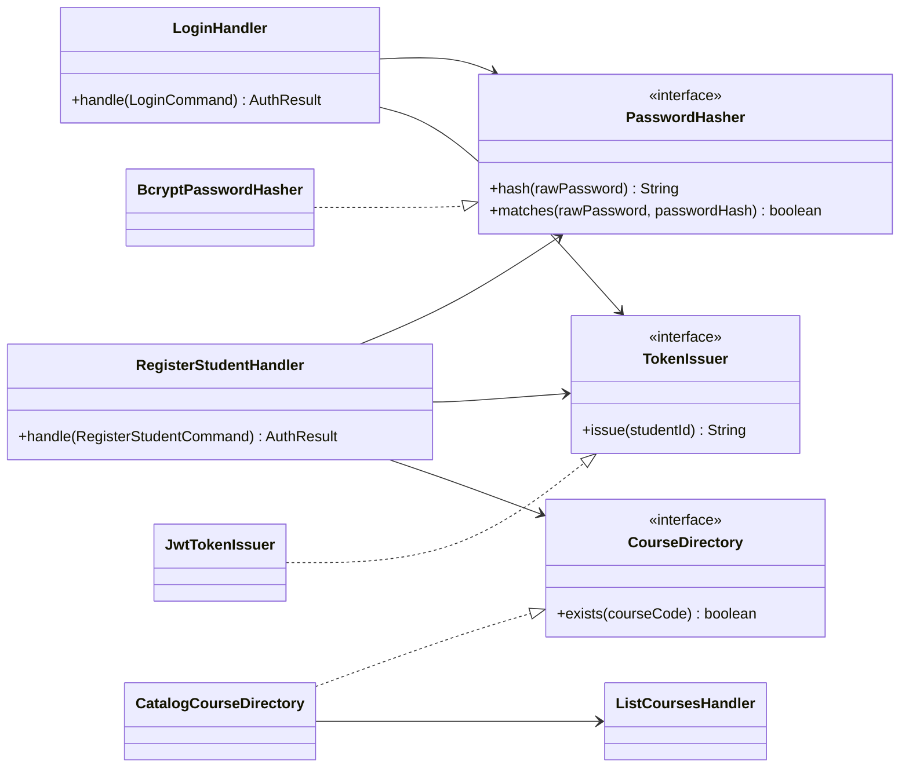

### 5.2 Repository + Adapter + Data Mapper

**Onde:** `StudentRepository`, `CourseRepository`, `ProfessionalRepository`, `SlotRepository`, `AppointmentRepository` e os `*RepositoryAdapter`.
**Por quê:** o domínio expõe uma "coleção" de aggregates sem saber de JPA. O adapter faz o **mapeamento** entity ↔ domínio (`toDomain` com `restore`), então as classes de domínio ficam sem anotações, imutáveis e com construtor privado. Também é o adapter quem **traduz erros de infraestrutura em exceções de domínio** (`DataIntegrityViolationException` → `SlotUnavailableException` / `EmailAlreadyRegisteredException`). Custo: duplicação de campos entre domínio e entity, aceita em troca de isolamento.

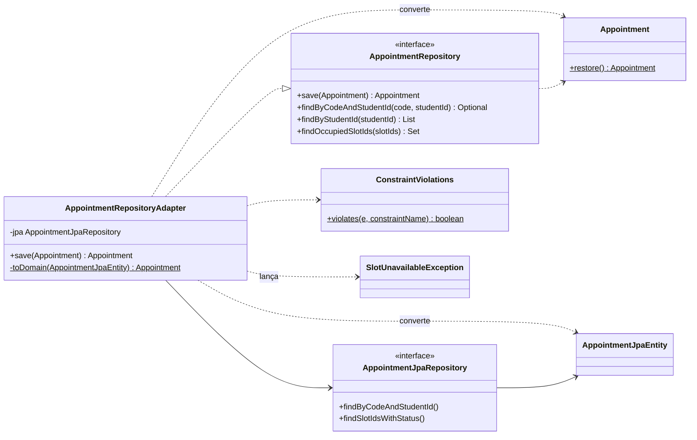

### 5.3 Anti-Corruption Layer entre contextos

**Onde:** `CatalogCourseDirectory`, `SchedulingProfessionalAvailability`, `CatalogResponsibleDirectory` (pacotes `infrastructure/integration`).
**Por quê:** cada contexto tem seu próprio vocabulário (`ResponsibleInfo` no agendamento, `ProfessionalSummary` no catálogo). O adapter traduz de um modelo para o outro e consome só o **handler público** do vizinho, nunca suas tabelas ou repositórios. Se um contexto virar serviço separado, só o adapter muda (de chamada local para HTTP). Os adapters são package-private: ninguém os usa diretamente, só o Spring.

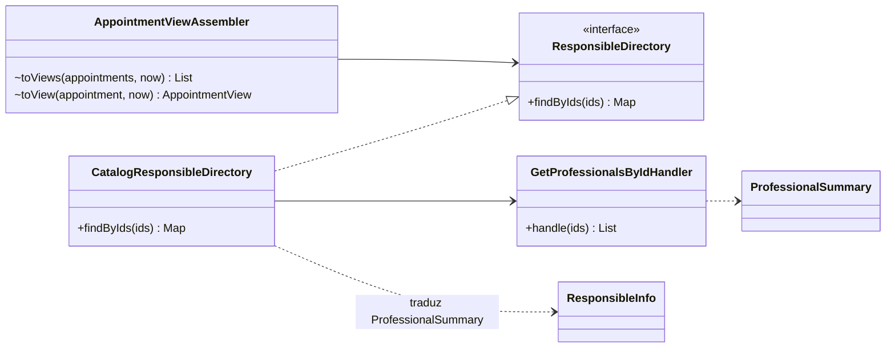

### 5.4 Blocos táticos de DDD: Aggregate Root, Entity, Value Object, Factory Method

**Onde:** `Student`, `Professional`, `Appointment` (aggregate roots); `Course`, `Slot` (entities); `UcsalEmail`, `AppointmentCode`, `Reason` (value objects).
**Por quê:**
- **Construtor privado + fábricas estáticas** (`create`/`register`/`schedule`/`of`/`fromInput`): o objeto nunca existe inválido. A regra mora **dentro** do domínio, não espalhada nos handlers.
- **Duas fábricas por classe**: `create`/`schedule`/`of` validam (novo dado); `restore` reconstitui dado já validado vindo do banco (não revalida, não falha por regra que mudou).
- **Value objects** com `equals`/`hashCode` por valor encapsulam formato e normalização (`UcsalEmail` normaliza; `AppointmentCode` formata; `Reason` descarta vazio).
- **`Appointment` guarda snapshot** do slot: uma vez criado, não depende da evolução do slot.
- **Tempo como parâmetro** (`now`): `schedule(…, now)`, `cancel(now)`, `statusAt(now)`. Nada de `Instant.now()` dentro do domínio.

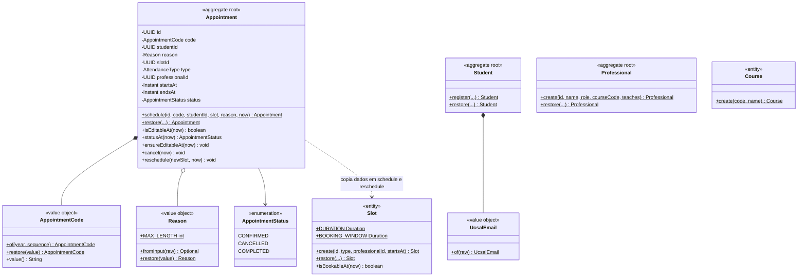

### 5.5 Command / Query handlers (CQRS leve) e DTO/View

**Onde:** todas as classes `*Handler`, `*Command`, `*Query`, `*View`.
**Por quê:** **um caso de uso por classe**, com nome de intenção, uma única operação (`handle`) e transação própria (`@Transactional` para escrita, `readOnly = true` para leitura). Entradas e saídas são *records* imutáveis, então o controller não conhece o domínio e o domínio não conhece o HTTP. Não é CQRS completo (mesmo banco, mesmo modelo): é a separação conceitual comando/consulta, com custo baixo.

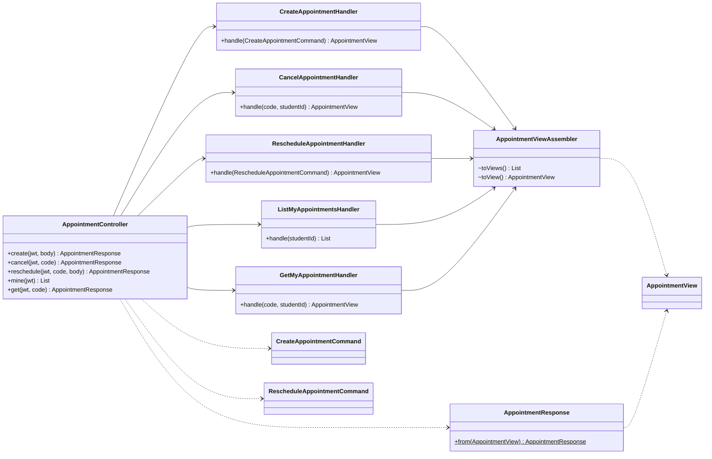

O `AppointmentViewAssembler` (padrão **Assembler/Mapper**) existe para que os cinco handlers montem a visão do mesmo jeito, com a busca de responsáveis em lote.

### 5.6 Hierarquia de exceções + Exception Handler centralizado

**Onde:** `DomainException` e subclasses; `GlobalExceptionHandler`.
**Por quê:** o domínio expressa o erro com um `ErrorCode` semântico, sem saber de HTTP. A tradução para status e envelope JSON fica em **um só lugar**, garantindo contrato uniforme. O `switch` exaustivo sobre `ErrorCode` força o mapeamento de novos códigos.

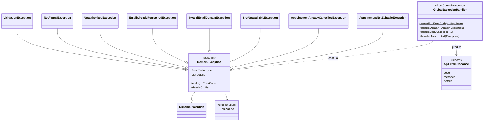

### 5.7 Outros padrões e técnicas

| Padrão / técnica | Onde | Por quê |
|---|---|---|
| **Injeção de dependência por construtor** | Todo o backend | Dependências explícitas, campos `final`, fácil de testar sem Spring. |
| **Relógio injetável** (`Clock`) | `ClockConfig` e handlers | Testes determinísticos; domínio recebe `now`. |
| **Shared Kernel** | `shared.kernel` | Compartilha só o mínimo (enum, exceções base, fuso). Evita acoplamento maior entre contextos. |
| **Restrição no banco como fonte de verdade** (controle de concorrência otimista via constraint) | `ux_appointments_active_slot`, `uk_students_email`, `uk_appointments_code` | Checar na aplicação antes de gravar é sujeito a corrida; a constraint é atômica. |
| **Contador por upsert atômico** | `JdbcAppointmentCodeCounter` | Código sequencial por ano sem `SELECT MAX`. Está na mesma transação: se o agendamento falha, o número volta, sem buracos. Efeito colateral: serializa a criação de agendamentos do mesmo ano (lock da linha do ano). Aceitável para o volume do MVP. |
| **Anti-enumeração** | `LoginHandler`, `GetMyAppointmentHandler` | Mesma resposta para "não existe" e "não é seu". |
| **Package-private por padrão** | adapters, `*JpaRepository`, `GlobalExceptionHandler`, `SecurityConfig`, `AppointmentViewAssembler` | Só as interfaces (ports) e handlers são públicos; detalhes de infraestrutura ficam encapsulados no pacote. |
| **Composition root dos dados demo** | `DemoDataSeeder` | Único lugar que "conhece todo mundo" para montar o cenário de demonstração. |

---

## 6. Banco de dados

Migrações Flyway em `backend/src/main/resources/db/migration`; `ddl-auto: validate` garante que as entities batem com o schema (o Hibernate **não** altera o banco).

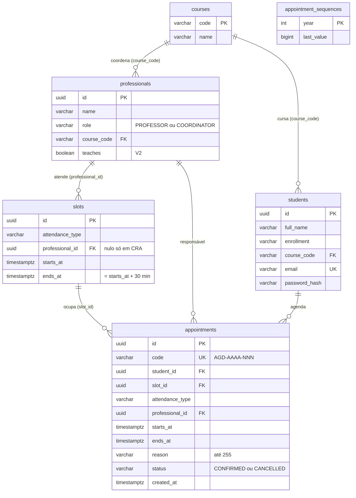

Regras no banco (defesa em profundidade, espelham o domínio): coordenador exige curso e professor não pode ter; duração do slot é exatamente 30 min; `CRA ⇔ professional_id IS NULL`; **índice único parcial** `ux_appointments_active_slot ON appointments(slot_id) WHERE status = 'CONFIRMED'`.

---

## 7. Frontend: arquitetura e referência

O frontend usa **MVVM por feature**. Cada feature (`auth`, `catalog`, `slots`, `booking`, `appointments`) tem as subpastas:

| Pasta | Papel |
|---|---|
| `model/` | Tipos, DTOs, mapeadores `toX(dto)` e regras puras (testáveis sem React). |
| `api/` | Funções que chamam o backend e devolvem modelos já convertidos. |
| `viewmodel/` | Hooks que guardam estado e orquestram a feature. É a "cola". |
| `view/` | Componentes de apresentação da feature. |

Fora das features: `pages/` (uma tela por rota, compõe viewmodel + view + layout), `components/` (reutilizáveis sem regra de negócio), `components/ui/` (primitivas shadcn/Radix geradas), `lib/` (infraestrutura), `domain/` (conceitos compartilhados), `app/` (roteamento).

```mermaid
flowchart TB
    PG["pages/*: Page"] --> VM["viewmodel: hooks e Providers"]
    PG --> VW["view e components: apresentação"]
    VW --> UI["components/ui: shadcn"]
    VM --> API["api: authApi, catalogApi, slotsApi, appointmentsApi"]
    VM --> MD["model: tipos, reducer, regras puras"]
    API --> HTTP["lib/http/apiClient: apiRequest e ApiError"]
    HTTP --> ST["lib/storage/session: token"]
    API --> MD
```

### 7.1 Roteamento (`app/App.tsx`)

```mermaid
flowchart TD
    R["createBrowserRouter"] --> AUTH["AuthProvider (raiz)"]
    AUTH --> LOGIN["/entrar: AuthPage"]
    AUTH --> RA["RequireAuth"]
    RA --> BP["BookingProvider"]
    BP --> A1["/ redireciona para /agendar"]
    BP --> A2["/agendar: BookingTypePage"]
    BP --> A3["/agendar/responsavel: BookingProfessionalPage"]
    BP --> A4["/agendar/horario: BookingSlotPage"]
    BP --> A5["/agendar/revisao: BookingReviewPage"]
    BP --> A6["/confirmacao/:code: BookingSuccessPage"]
    BP --> A7["/agendamentos: MyAppointmentsPage"]
    BP --> A8["/agendamentos/:code/reagendar: ReschedulePage"]
    BP --> A9["/agendamentos/:code/reagendado: RescheduledPage"]
    BP --> A10["/agendamentos/:code/cancelado: CancelledPage"]
    BP --> A11["/agendamentos/:code/erro/:motivo: AppointmentErrorPage"]
    BP --> A12["*: NotFoundPage"]
```

`AuthProvider` envolve tudo (login precisa dele); `BookingProvider` fica dentro de `RequireAuth` e acima das rotas privadas para o rascunho sobreviver à navegação entre etapas.

### 7.2 `lib/`, `domain/`, `app/`

| Arquivo | O que faz |
|---|---|
| `main.tsx` | Monta `<App/>` em `StrictMode`. |
| `app/App.tsx` | Define o router e a hierarquia de providers. |
| `app/RequireAuth.tsx` | *Route guard*: `loading` → esqueleto acessível; `anonymous` → `Navigate /entrar` guardando o destino em `state.from`; senão `Outlet`. |
| `lib/http/apiClient.ts` | `apiRequest<T>(path, {method, body, expireSessionOn401})`: adiciona `Authorization: Bearer`, serializa JSON, trata falha de rede (`ApiError` status 0), converte erro do contrato em `ApiError(status, code, message, details)`. Em 401 dispara o evento `auth:expired`, **exceto** login/cadastro (onde 401 tem outro significado). `ApiError` é a classe de erro tipada que os viewmodels inspecionam. |
| `lib/storage/session.ts` | `readToken/writeToken/clearToken` com `localStorage` e **fallback em memória** quando o storage está bloqueado (aba privada). |
| `lib/env.ts` | Variáveis `VITE_*` (`apiUrl`, `demoEmail`). Nunca segredos: vão para o bundle. |
| `lib/datetime.ts` | Formatadores `Intl` fixos em `America/Sao_Paulo` (`dayKey`, `formatTime`, `formatShortWhen`, `formatAppointmentWhen`, `formatLongDate`...), independentes do fuso do navegador. Instâncias de `Intl.DateTimeFormat` criadas uma vez (são caras). |
| `lib/utils.ts` | `cn(...)`: `clsx` + `tailwind-merge`. |
| `domain/attendance.ts` | `ATTENDANCE_OPTIONS` (rótulo, descrição, `needsProfessional`), `attendanceOption`, `attendanceLabel`. É a regra "CRA não tem responsável" no cliente. |

### 7.3 Feature `auth`

| Arquivo | O que faz |
|---|---|
| `model/types.ts` | `User`, `AuthSession`, `RegisterInput`, `RegisterErrors`. |
| `model/validation.ts` | `validateRegister` (espelho das regras do servidor para feedback imediato), `isUcsalEmail`, `mapServerFieldErrors` (converte `details` do 400 em erros por campo). **O servidor continua sendo a fonte de verdade.** |
| `api/authApi.ts` | `register`, `login`, `me`. Login e cadastro usam `expireSessionOn401: false`. |
| `viewmodel/AuthContext.ts` | Tipo do contexto: `status` (`loading` / `anonymous` / `authenticated`), `user`, `sessionMessage`, `login`, `register`, `logout`. |
| `viewmodel/AuthProvider.tsx` | Mantém a sessão. Efeito 1: restaura sessão com `GET /auth/me` se houver token (só apaga o token em 401; falha de rede mantém). Efeito 2: escuta `auth:expired`. `startSession` grava token e muda estado. Valor do contexto memoizado. |
| `viewmodel/useAuth.ts` | Hook de acesso; lança erro se usado fora do provider. |
| `viewmodel/useLoginViewModel.ts` | Estado e envio do formulário de login; `fillDemoAccount` preenche só o e-mail da conta demo; `loginErrorMessage` traduz o erro. |
| `viewmodel/useRegisterViewModel.ts` | Estado do cadastro; busca cursos via `useCoursesViewModel`; `checkEmail` valida no `onBlur`; `submit` mapeia `EMAIL_ALREADY_REGISTERED`, `INVALID_EMAIL_DOMAIN` e `VALIDATION_ERROR` para campos. |
| `view/LoginForm.tsx`, `view/RegisterForm.tsx` | Apenas renderização; recebem o viewmodel por props. |
| `pages/AuthPage.tsx` | Alterna login/cadastro; se já autenticado, volta a `state.from`. |

### 7.4 Feature `catalog` e `slots`

| Arquivo | O que faz |
|---|---|
| `catalog/api/catalogApi.ts` | `courses()`, `professionals(type)` (somente `COORDINATION`/`PROFESSOR`). |
| `catalog/model/types.ts` | DTOs, `Professional`, `toProfessional`, `initialsOf` (iniciais para o avatar, ignorando "Prof."/"Profa."). |
| `catalog/viewmodel/useCoursesViewModel.ts` | Carrega cursos com estado `loading/ready/error`. |
| `catalog/viewmodel/useProfessionalsViewModel.ts` | Carrega responsáveis, `filterProfessionals` (busca por nome ou curso, sem diferenciar maiúsculas em pt-BR), `reload`. |
| `catalog/view/ProfessionalList.tsx` | Lista com estados de carga, erro, vazio e busca. |
| `slots/api/slotsApi.ts` | `list(type, professionalId?)`: **não envia** `professionalId` para CRA. |
| `slots/model/types.ts` | `Slot`, `toSlot` (ISO → `Date`). |
| `slots/model/slotDays.ts` | `groupSlotsByDay` agrupa por dia no fuso do app; `defaultDayKey` escolhe o primeiro dia com vaga. |
| `slots/viewmodel/useSlotsViewModel.ts` | Carrega a janela, expõe `days`, `selectedDay`, `selectDay`, `reload`. Aceita `query = null` (agendamento ainda carregando). |
| `slots/view/SlotPicker.tsx` | `DayStrip` + `SlotGrid` com legenda em texto. |

Padrão repetido em todos os hooks de carga: `useEffect` com flag `active` (descarta resposta de requisição obsoleta após desmontar ou mudar parâmetro) e `reloadKey` para recarregar.

### 7.5 Feature `booking`

| Arquivo | O que faz |
|---|---|
| `model/types.ts` | `BookingDraft {type, professional, slot, reason}` e `EMPTY_DRAFT`. |
| `model/bookingReducer.ts` | Reducer puro. Trocar o **tipo** zera responsável e horário; trocar **responsável** zera horário; `slotUnavailable` zera só o horário (mantém o resto, RF-12); `reset` volta ao vazio. Retorna o mesmo estado se nada mudou (evita re-render). |
| `model/flow.ts` | Regras do assistente: `stepsFor(type)` (CRA = 3 passos, demais = 4), `isStepReachable`, `canContinue`, `nextStep`, `previousStep`, `BOOKING_PATHS`. |
| `model/reason.ts` | `REASON_MAX_LENGTH = 255`, `isReasonValid`, `toReasonPayload` (vazio vira `null`). |
| `viewmodel/BookingProvider.tsx` + `BookingContext.ts` | `useReducer` exposto por contexto. |
| `viewmodel/useBookingViewModel.ts` | Ações `chooseType`, `chooseProfessional`, `chooseSlot`, `setReason`, `reset` e `submit`. `submit` revalida com `canContinue('review')`, chama `appointmentsApi.create` e devolve `SubmitOutcome` (`confirmed` / `slot-unavailable` / `error`). Em `SLOT_UNAVAILABLE` despacha `slotUnavailable`. |
| `view/RequireBookingStep.tsx` | *Guard* de etapa: redireciona a `/agendar` se `isStepReachable` for falso. |
| `view/BookingStepper`, `AttendanceTypeList`, `ReasonField`, `ReviewSummary` | Apresentação do assistente. |
| `pages/booking/*` | Uma página por etapa; navegam usando `nextStep/previousStep` e `BOOKING_PATHS`. `BookingReviewPage` redireciona à confirmação com `replace`; em conflito volta ao horário com um `SlotConflictState` na navegação. `BookingSuccessPage` limpa o rascunho (`reset`) só **depois** de carregar, porque limpar antes faria `RequireBookingStep` redirecionar. |

### 7.6 Feature `appointments`

| Arquivo | O que faz |
|---|---|
| `model/types.ts` | `AppointmentDto` → `Appointment` (`toAppointment` converte datas). `editable` vem do servidor e **não é recalculado** no cliente. |
| `model/status.ts` | `describeAppointment(appointment, now)` mapeia status + `editable` para rótulo, tom, ícone e grupo (inclui "Em andamento"); `groupAppointments` separa próximos e anteriores. `now` é injetado (testável). |
| `api/appointmentsApi.ts` | `create`, `listMine`, `get`, `cancel`, `reschedule`; usa `encodeURIComponent` no código. |
| `viewmodel/useAppointmentViewModel.ts` | Carrega um agendamento por código; estados `loading/ready/not-found/error`. |
| `viewmodel/useMyAppointmentsViewModel.ts` | Lista, agrupa e expõe `cancel`. |
| `viewmodel/useRescheduleViewModel.ts` | Compõe `useAppointmentViewModel` + `useSlotsViewModel` (mesmo tipo e responsável do original). `submit` devolve `RescheduleOutcome` (união discriminada) e trata `SLOT_UNAVAILABLE` limpando a seleção e recarregando. |
| `view/AppointmentCard`, `CancelDialog`, `AppointmentResult` | Card da lista, diálogo de confirmação de cancelamento (fica aberto até a resposta) e layout das telas de resultado. |
| `pages/appointments/*` | `MyAppointmentsPage`, `ReschedulePage`, e em `AppointmentResultPages.tsx` `CancelledPage`, `RescheduledPage`, `AppointmentErrorPage` (compartilham o hook local `useResultAppointment`). O horário anterior no reagendamento viaja pelo `location.state`. |

### 7.7 `components/`

Componentes reutilizáveis sem regra de negócio: `AppointmentSummary` (lista de pares rótulo/valor), `ConfirmationCode`, `DayStrip`, `SlotGrid`, `ProfessionalCard`, `SelectableCard` (base de cartões selecionáveis), `StepIndicator`, `StepActions`, `StatusBadge`, `FormField` (liga rótulo, controle e erro por `id`/`aria-describedby`), `ErrorAlert`, `StateMessage` (`LoadingState`, `LoadErrorState`, `EmptyState`), `PageHeading`. Em `layout/`: `AppLayout` (cabeçalho, conteúdo, rodapé de ação, tema, largura), `AppHeader` (logout e navegação), `BottomTabs` (mobile), `navItems`. Acessibilidade: estados nunca dependem só de cor; erros usam `role` de alerta; carregamento tem texto para leitor de tela.

---

## 8. Padrões de projeto do frontend

### 8.1 MVVM por feature

**Por quê:** a lógica (estado, chamadas, tratamento de erro) sai do componente e vai para hooks; a view só renderiza. Isso permite testar o viewmodel e o model sem DOM e trocar a UI sem tocar a regra. O `model/` puro (reducer, `flow`, `status`, `slotDays`, `validation`) é o que tem testes unitários.

```mermaid
classDiagram
    direction LR
    class BookingReviewPage {
        <<View / Page>>
    }
    class ReviewSummary {
        <<View>>
    }
    class useBookingViewModel {
        <<ViewModel hook>>
        +draft
        +chooseType()
        +chooseProfessional()
        +chooseSlot()
        +setReason()
        +submit() SubmitOutcome
        +reset()
    }
    class BookingContext {
        <<Context>>
        draft
        dispatch
    }
    class bookingReducer {
        <<Model: função pura>>
        +bookingReducer(state, action) BookingDraft
    }
    class flow {
        <<Model: regras>>
        +stepsFor(type)
        +isStepReachable(step, draft)
        +canContinue(step, draft)
    }
    class appointmentsApi {
        <<Facade>>
        +create(input) Appointment
    }
    BookingReviewPage --> useBookingViewModel
    BookingReviewPage --> ReviewSummary
    useBookingViewModel --> BookingContext
    useBookingViewModel --> flow
    useBookingViewModel --> appointmentsApi
    BookingContext --> bookingReducer
```

### 8.2 Provider (Context) + Reducer (estilo Flux/Redux)

**Onde:** `AuthProvider`/`AuthContext`; `BookingProvider`/`BookingContext`/`bookingReducer`.
**Por quê:** estado compartilhado por várias telas (sessão; rascunho do agendamento) sem *prop drilling*. O reducer concentra **todas** as transições do rascunho em uma função pura (`BookingAction` é uma união discriminada), o que garante, por exemplo, que mudar o tipo sempre invalida horário e responsável. Sem biblioteca externa de estado, porque o escopo é pequeno.

```mermaid
classDiagram
    direction LR
    class BookingDraft {
        type
        professional
        slot
        reason
    }
    class BookingAction {
        <<union>>
        chooseType
        chooseProfessional
        chooseSlot
        setReason
        slotUnavailable
        reset
    }
    class bookingReducer {
        +reduce(state, action) BookingDraft
    }
    class BookingProvider {
        useReducer(bookingReducer, EMPTY_DRAFT)
    }
    class BookingContext
    class useBookingViewModel
    BookingProvider --> bookingReducer
    BookingProvider --> BookingContext : fornece draft e dispatch
    useBookingViewModel --> BookingContext : consome
    bookingReducer ..> BookingAction
    bookingReducer ..> BookingDraft
```

### 8.3 Route Guards

**Onde:** `RequireAuth` (sessão) e `RequireBookingStep` (pré-condições de cada etapa, via `isStepReachable`).
**Por quê:** a proteção fica **declarada na árvore de rotas**, não repetida em cada página. Como a regra está em `flow.ts` (função pura), serve tanto ao guard quanto à navegação (`nextStep`).

```mermaid
classDiagram
    direction LR
    class RequireAuth {
        +render() Outlet ou Navigate
    }
    class RequireBookingStep {
        +render() children ou Navigate
    }
    class useAuth
    class useBookingViewModel
    class flow {
        +isStepReachable(step, draft) boolean
    }
    RequireAuth --> useAuth
    RequireBookingStep --> useBookingViewModel
    RequireBookingStep --> flow
```

### 8.4 Facade, Adapter e Mapper (camada de API)

**Onde:** `authApi`, `catalogApi`, `slotsApi`, `appointmentsApi`, `apiClient`, `toAppointment`/`toSlot`/`toProfessional`.
**Por quê:** os viewmodels falam com objetos de API de alto nível (`appointmentsApi.cancel(code)`), sem saber de `fetch`, cabeçalhos ou URLs. Os `toX(dto)` isolam o formato do contrato (datas como string) do modelo da UI (`Date`): se o contrato mudar, só o mapper muda. `ApiError` padroniza falhas (rede, HTTP, contrato) em um único tipo.

```mermaid
classDiagram
    direction LR
    class useMyAppointmentsViewModel
    class appointmentsApi {
        <<Facade>>
        +create(input)
        +listMine()
        +get(code)
        +cancel(code)
        +reschedule(code, slotId)
    }
    class AppointmentDto {
        startsAt string
        endsAt string
    }
    class Appointment {
        startsAt Date
        endsAt Date
    }
    class toAppointment {
        <<Mapper>>
        +toAppointment(dto) Appointment
    }
    class apiRequest {
        <<HTTP client>>
        +apiRequest(path, options) T
    }
    class ApiError {
        status
        code
        message
        details
    }
    class session {
        +readToken()
        +writeToken()
        +clearToken()
    }
    useMyAppointmentsViewModel --> appointmentsApi
    appointmentsApi --> apiRequest
    appointmentsApi ..> toAppointment
    toAppointment ..> AppointmentDto
    toAppointment ..> Appointment
    apiRequest --> session
    apiRequest ..> ApiError : lança
```

### 8.5 Observer (evento global de sessão expirada)

**Onde:** `apiClient` dispara `window.dispatchEvent(new Event('auth:expired'))`; `AuthProvider` escuta.
**Por quê:** o cliente HTTP (camada baixa) não pode importar React nem o `AuthProvider` (camada alta). O evento desacopla: qualquer 401 em qualquer chamada derruba a sessão em um só lugar, com mensagem ao usuário.

### 8.6 Resultado como união discriminada (tagged union)

**Onde:** `SubmitOutcome`, `RescheduleOutcome`.
**Por quê:** o viewmodel **decide o que aconteceu** (`confirmed`, `slot-unavailable`, `not-editable`, `error`) e a página só decide para onde navegar. O compilador obriga a tratar todos os casos.

### 8.7 Outras técnicas

| Técnica | Onde | Por quê |
|---|---|---|
| **Cancelamento de efeito (`active` flag)** | Todos os hooks de carga | Evita *setState* após desmontar e respostas fora de ordem. |
| **Funções puras no model** | `status.ts`, `slotDays.ts`, `flow.ts`, `validation.ts`, `reason.ts` | Testáveis sem React; `now` injetado em vez de `new Date()`. |
| **Validação espelhada** | `validation.ts`, `reason.ts` | Feedback imediato; o servidor revalida (nunca confiar só no cliente). |
| **Fallback de armazenamento** | `session.ts` | O app funciona mesmo com `localStorage` bloqueado. |
| **Dados do servidor como fonte de verdade** | `editable`, `status`, `available` | O cliente não reimplementa regras de tempo e de ocupação. |

---

## 9. Decisões transversais, pontos de atenção e testes

### 9.1 Decisões transversais

- **Tempo:** UTC no banco (`timestamptz`) e em memória (`Instant`); conversão para `-03:00` só na borda (`ApiDateTimes`). O código `AGD-AAAA` usa o ano em `America/Bahia`.
- **Segurança:** JWT HS256 *stateless*; segredo ≥ 32 bytes validado no boot; senha com BCrypt; CORS restrito a `GET/POST/OPTIONS` e às origens de `CORS_ORIGINS`; nenhum segredo no código (`.env`); respostas de login e de recurso alheio sem enumeração.
- **Contrato de erro único** (`{code, message, details}`), inclusive nos erros do Spring Security.
- **Defesa em profundidade:** a mesma regra existe no domínio **e** em constraints do banco (duração do slot, CRA sem responsável, coordenador com curso, unicidades).

### 9.2 Pontos de atenção (observados na leitura do código)

1. **`DemoDataSeeder` executa `TRUNCATE` em todas as tabelas a cada boot** e não é condicionado a perfil. Adequado para a demonstração acadêmica; em qualquer ambiente com dados reais é destrutivo. Recomenda-se um `@Profile("demo")` ou flag de configuração.
2. **Dependência de módulo bidirecional** entre `catalog` e `scheduling` (via adapters). Sem ciclo de beans hoje, mas qualquer chamada direta nova pode criá-lo.
3. **`StudentRepositoryAdapter.violates`** duplica `ConstraintViolations.violates` do `shared`. Pode reutilizar a classe compartilhada.
4. **Contador de código serializa por ano** (lock da linha em `appointment_sequences` até o fim da transação). Ok para o MVP; seria gargalo em alta concorrência.
5. **Fusos com nomes diferentes:** backend usa `America/Bahia`, frontend `America/Sao_Paulo`. Hoje ambos são `-03:00` sem horário de verão, então o resultado coincide; vale unificar para evitar divergência se as regras de DST mudarem.
6. **`CatalogCourseDirectory.exists`** lista todos os cursos para procurar um código (O(n)); irrelevante com 3 cursos.
7. **Horário anterior no reagendamento:** a API devolve `previousStartsAt/previousEndsAt` na resposta do `POST /reschedule`, mas o frontend (`AppointmentDto`) não os lê; usa o `startsAt` do agendamento antes da chamada e o repassa por `location.state`. Funciona, mas o campo da API fica sem uso no cliente (comentário em `AppointmentResultPages.tsx` diz que a API não o retorna, o que não é verdade).

### 9.3 Testes existentes

| Teste | Cobre |
|---|---|
| `AgendaApiIntegrationTest` (Testcontainers) | Cadastro, domínio de e-mail, duplicidade, login, `/me`, cursos públicos, `hasSlots`, coordenador que não leciona, slots exigem auth/responsável, offset `-03:00`, ciclo de vida do agendamento, isolamento entre alunos, rotas protegidas, envelope de 404. |
| `UcsalEmailTest`, `AppointmentCodeTest`, `ReasonTest`, `SlotTest`, `AppointmentTest` | Regras de domínio puras, sem Spring. |
| Frontend (`vitest`): `status.test`, `validation.test`, `bookingReducer.test`, `reason.test`, `slotDays.test`, `useBookingViewModel.test` | Model puro e o viewmodel do assistente. |

Lacunas: não há testes dos handlers com *fakes* dos ports, nem de concorrência real (duas requisições simultâneas ao mesmo slot), nem de componentes React.
